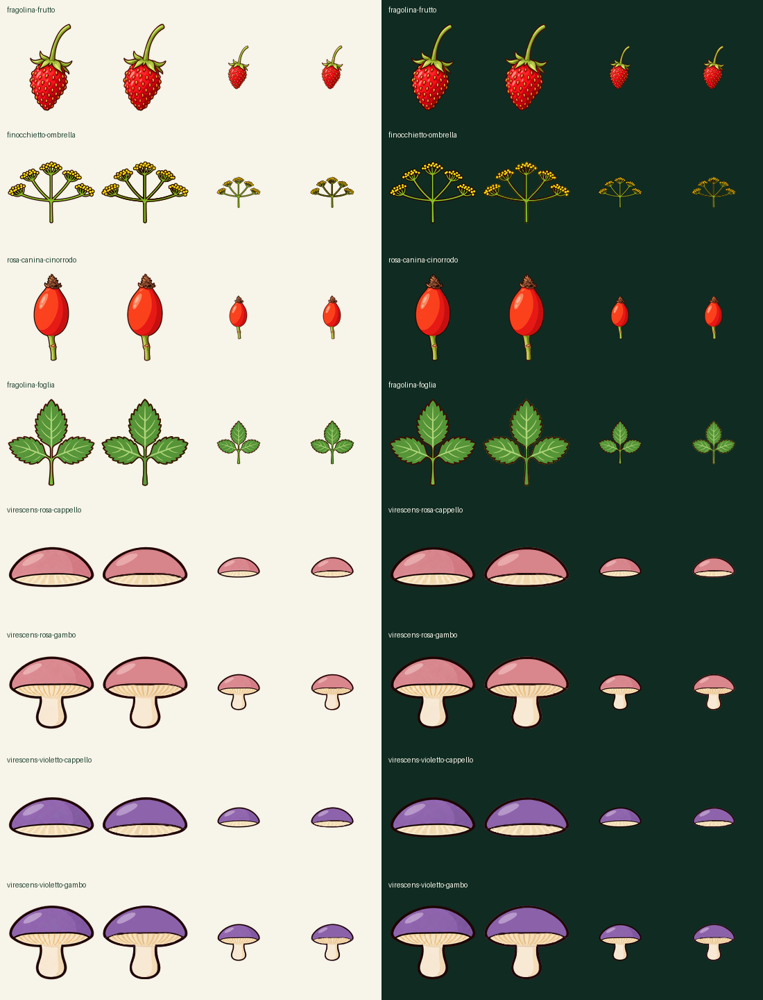

# Sorgenti editabili revisionate · 18 ottobre 2026

Otto SVG derivati dai raster approvati: quattro dettagli botanici e quattro varianti di russule lisce. La fragolina usa la proposta ottimizzata (576986 byte). Licenza CC BY-SA 4.0, autore Fronda/Fungaroli; dettagli di provenienza nei record dei singoli soggetti.

[Valutazione indipendente e decisione proposta](../../ipotesi/revisione-svg-2026-10-18.md). [Manifest con hash, dati e collegamento ai WebP nell'app](manifest.json).

Gli otto WebP esistenti restano nelle schede e nel confronto: gli SVG sono sorgenti editabili, non nuove immagini aggiunte al catalogo né file caricati dalla UI. Non cambiano il numero di specie o caratteri coperti.

Ogni cartella contiene `semantic.svg`, il raster ritagliato `source.png`, annotazioni `anatomy.json`, record di provenienza e revisione/prompt del raster. L'archivio conserva i record originali: alcuni percorsi di laboratorio nei record sono storici e non sono necessari per aprire questi file. Non usare nomi di livelli o la possibilità di ritintarli come prova di validità di nuove varianti.

